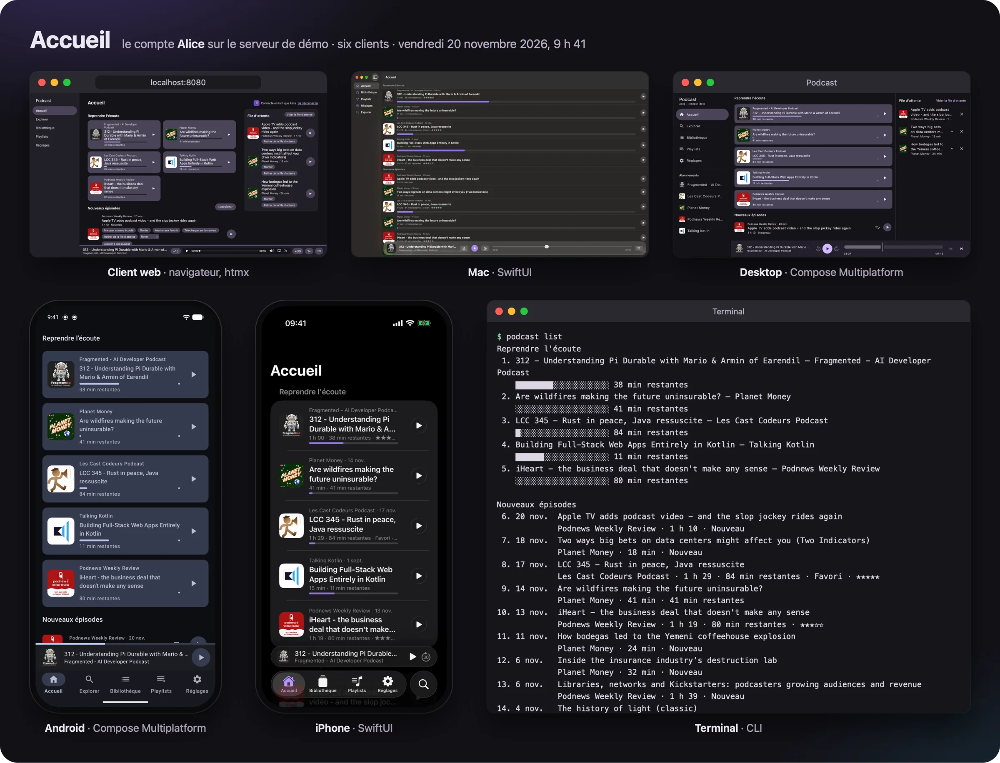
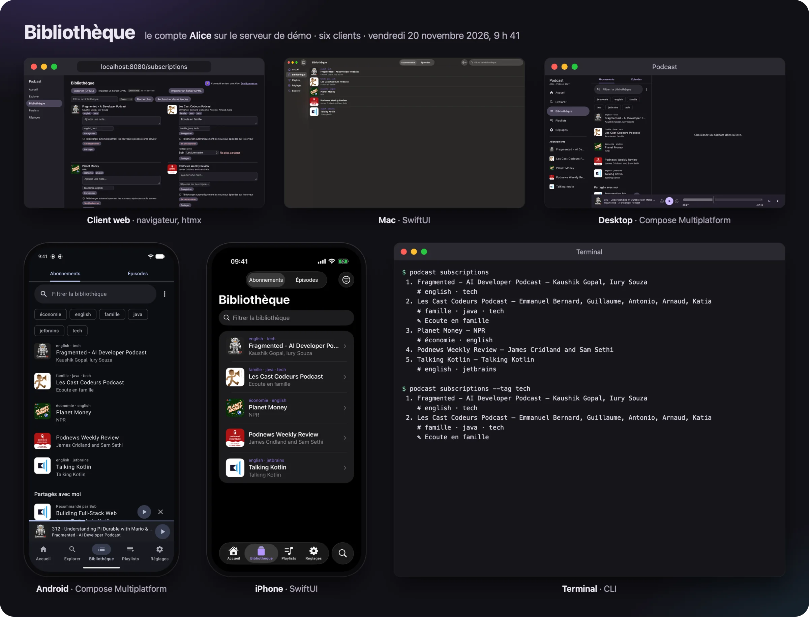
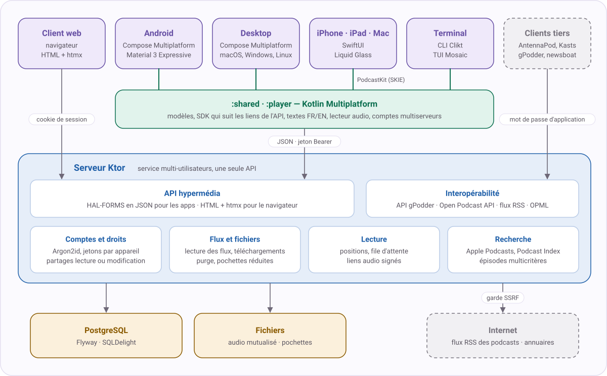

<div align="center">

# Podcast

**Un service de podcasts multi-utilisateurs, et six clients sur la même API.**<br>
Web · Android · iPhone, iPad et Mac · desktop · terminal

<sub>Projet de master · Kotlin Multiplatform · Ktor · Compose Multiplatform · SwiftUI</sub>

</div>



<p align="center"><sub>Le même compte, au même instant, sur les six clients : mêmes épisodes à reprendre, même file d'attente, mêmes nouveautés.</sub></p>

## En bref

- **Un service** (Ktor et PostgreSQL) suit les flux, garde les fichiers audio et les pochettes, et retient pour chaque utilisateur sa position, sa file d'attente, ses favoris et ses playlists.
- **Une API hypermédia** : du JSON HAL-FORMS pour les apps et du HTML (htmx) pour le navigateur, sur les mêmes routes. Les clients suivent les liens et les formulaires que le serveur leur propose ; ils ne construisent aucune adresse.
- **Un SDK Kotlin partagé** (`:shared`) : modèles, client de l'API, textes français et anglais. Les apps Compose, l'app SwiftUI et le terminal s'en servent tous.
- **Ouvert aux autres applis** : AntennaPod et les clients gPodder se synchronisent avec le serveur ; l'OPML et le flux RSS d'une playlist marchent partout.

## Fonctionnalités par application

| | Web | Android · desktop<br><sub>Compose</sub> | iPhone · iPad · Mac<br><sub>SwiftUI</sub> | Terminal<br><sub>CLI et TUI</sub> |
|---|:-:|:-:|:-:|:-:|
| S'abonner : recherche (Apple Podcasts, Podcast Index) ou adresse RSS | ✓ | ✓ | ✓ | ✓ |
| Import et export OPML | ✓ | ✓ | ✓ | ✓ |
| Note et étiquettes d'un abonnement, bibliothèque filtrée | ✓ | ✓ | ✓ | ✓ |
| Recherche multicritère des épisodes | ✓ | ✓ | ✓ | ✓ |
| Écouter, reprendre au même endroit sur un autre client | ✓ | ✓ | ✓ | ✓ |
| File d'attente | ✓ | ✓ | ✓ | ✓ |
| Lecture en arrière-plan, écran verrouillé | | ✓ | ✓ | |
| Chapitres et transcription (Podcast 2.0) | | ✓ | | |
| Téléchargement sur le serveur, épisode gardé | ✓ | ✓ | | |
| Favoris et notes | ✓ | ✓ | | ✓ |
| Playlists statiques et dynamiques | ✓ | ✓ | écoute | ✓ |
| Flux RSS d'une playlist | ✓ | ✓ | | ✓ |
| Partager un abonnement ou une playlist, recommander un épisode | ✓ | ✓ | | ✓ |
| Mon écoute (statistiques) | ✓ | ✓ | ✓ | ✓ |
| Profil et avatar | ✓ | ✓ | ✓ | ✓ |
| Mot de passe, appareils, mots de passe d'application | ✓ | ✓ | | ✓ |
| Comptes du serveur (administrateur) | ✓ | ✓ | ✓ | ✓ |
| Plusieurs comptes, sur plusieurs serveurs | | ✓ | ✓ | ✓ |

Ce que chaque client ajoute :

- **Web** : rien à installer ; le lecteur continue d'une page à l'autre ; sur un grand écran, la file d'attente reste à côté des épisodes.
- **Android** (Compose) : Material 3 Expressive, couleurs du fond d'écran, notification et écran verrouillé.
- **Desktop** (Compose) : macOS, Windows et Linux ; menu « Lecture » et raccourcis clavier.
- **iPhone, iPad et Mac** (SwiftUI) : Liquid Glass, mini-lecteur au-dessus des onglets, Centre de contrôle, graphique Swift Charts.
- **Terminal** : listes numérotées réutilisables d'une commande à l'autre, TUI Mosaic qui lit les épisodes, statistiques en barres.

L'UI Compose tourne aussi sur iOS (`iosApp/`), pour montrer qu'elle est partagée ; sur iPhone, iPad et Mac, le client recommandé reste l'app SwiftUI.

Le serveur relit les flux en arrière-plan, télécharge les épisodes demandés une seule fois pour tous et purge les anciens. Seuls les administrateurs créent les comptes : il n'y a pas d'inscription libre ([ADR 0009](docs/adr/0009-comptes-et-partages.md)).

## Captures



<p align="center"><sub>Les mêmes abonnements, étiquettes et notes ; dans le terminal, le filtre par étiquette. Cliquer sur une image l'ouvre en taille réelle.</sub></p>

## Architecture

<picture>
  <source media="(prefers-color-scheme: dark)" srcset="docs/images/architecture-dark.svg">
  
</picture>

| Module | Cibles | Rôle |
|---|---|---|
| `:shared` | JVM, Android, iOS, macOS | Modèles, SDK (comptes, client qui suit les liens), textes FR/EN, jetons de design |
| `:player` | JVM, Android, iOS, macOS | Lecture audio : Media3, AVPlayer, JavaFX Media, contrôleur partagé |
| `:composeApp` | Android, iOS, desktop | UI Compose Multiplatform, responsive selon la taille de la fenêtre |
| `:androidApp`, `iosApp/` | Android, iOS | Points d'entrée de l'UI Compose |
| `:apple`, `appleApp/` | iOS, iPadOS, macOS | Framework `PodcastKit` (SKIE) et app SwiftUI |
| `:server` | JVM | Ktor : API hypermédia, client web, API gPodder et Open Podcast API ; PostgreSQL (Flyway, SQLDelight) |
| `:cli` | JVM | Commandes Clikt et TUI Mosaic |

Les décisions sont expliquées dans les [ADR](docs/adr/) : format hypermédia ([0003](docs/adr/0003-format-hypermedia.md)), persistance ([0004](docs/adr/0004-persistance.md)), authentification et droits ([0005](docs/adr/0005-authentification-et-droits.md)), multiserveur ([0006](docs/adr/0006-comptes-et-multiserveur.md)), lecture ([0008](docs/adr/0008-lecture-audio.md)), clients tiers ([0011](docs/adr/0011-synchronisation-clients-tiers.md)), composants natifs ([0013](docs/adr/0013-composants-natifs.md)).

## Démarrer

Il faut un JDK 17 ou plus récent (21 recommandé), le SDK Android, et Xcode 26 sur un Mac Apple Silicon pour iOS et macOS. Ni Docker ni PostgreSQL : le serveur de développement et les tests utilisent un PostgreSQL embarqué.

```bash
./gradlew :server:run
```

- http://localhost:8080 : le client web ; http://localhost:8080/docs : la documentation de l'API.
- Les données de démo viennent de vrais flux. Les comptes Alice (administratrice) et Bob sont décrits dans [DevSeed.kt](server/src/dev/kotlin/fr/podcast/server/dev/DevSeed.kt).
- Depuis cette machine seulement, http://localhost:8080/dev/login/alice connecte le navigateur sans mot de passe.

| Client | Commande |
|---|---|
| Android | `./gradlew :androidApp:installDebug` (serveur : `http://10.0.2.2:8080` depuis l'émulateur) |
| Desktop | `./gradlew :composeApp:run` |
| iPhone, iPad, Mac | ouvrir `appleApp/Podcast.xcodeproj`, schéma `Podcast` |
| iOS (Compose) | ouvrir `iosApp/iosApp.xcodeproj` |
| Terminal | `./gradlew :cli:installDist`, puis `cli/build/install/podcast/bin/podcast login` |

Le [guide d'utilisation](docs/guide.md) détaille chaque client : écoute, comptes et partages, playlists, recherche, AntennaPod et newsboat.

## Configuration

En production, le point d'entrée `fr.podcast.server.ApplicationKt` exige une vraie base (`DATABASE_URL`, `DATABASE_USER`, `DATABASE_PASSWORD`) et active les cookies `Secure`.

| Variable | Défaut | Rôle |
|---|---|---|
| `PORT`, `SERVER_NAME` | `8080`, `Podcast` | Port d'écoute et nom affiché aux clients |
| `ADMIN_USERNAME`, `ADMIN_PASSWORD` | aucune | Crée le premier administrateur, seulement si la base n'a aucun compte |
| `PODCASTINDEX_KEY`, `PODCASTINDEX_SECRET` | aucune | Ajoute Podcast Index à la recherche (sinon, Apple Podcasts seul) |
| `REFRESH_INTERVAL_MINUTES` | `60` | Délai avant de relire un flux |
| `MEDIA_DIR` | `media` | Dossier des fichiers audio et des pochettes réduites |
| `MEDIA_RETENTION_DAYS` | `30` | Âge à partir duquel un fichier est purgé (sauf épisode gardé ou en cours) |
| `MEDIA_MAX_GB` | aucun | Quota disque : au-delà, les fichiers les plus anciens partent |
| `AUTO_DOWNLOAD_LATEST` | `1` | Épisodes récents téléchargés pour un abonnement en téléchargement automatique |
| `ALLOW_PRIVATE_FEEDS` | `false` | Autorise les flux d'un réseau privé (développement seulement : protection SSRF) |

Un second serveur, pour essayer le multiserveur : `PORT=8081 SERVER_NAME="Serveur B" ./gradlew :server:run`.

## Tests

```bash
./gradlew :shared:allTests :player:jvmTest :composeApp:desktopTest :server:test :cli:test
```

- `ContractTest` vérifie que la spécification OpenAPI et les routes correspondent, et que chaque réponse respecte son schéma.
- `SdkTest` fait tourner le SDK de `:shared` contre le vrai serveur ; `ApiTest` et `WebTest` couvrent l'API et le client web.
- `:composeApp:desktopTest` dessine chaque écran à chaque taille de fenêtre et dans chaque langue, dans `composeApp/build/snapshots/`.

## Documentation

- [Guide d'utilisation](docs/guide.md) : chaque client, pas à pas.
- [Contrat de l'API](docs/api/README.md) : spécification OpenAPI, conventions, modèle de données.
- [Décisions d'architecture](docs/adr/) et [plan du projet](plan.md).
- [Scénario de la démo](docs/demo.md).
- [AGENTS.md](AGENTS.md) : consignes pour les agents de code qui travaillent sur ce dépôt.
