# Modèle de données

Base PostgreSQL du service, gérée par migrations Flyway et lue par SQLDelight (ADR 0004). Le modèle complet est décrit ici. Chaque table est créée par la migration de l'étape qui l'utilise : on ne crée pas de table sans code qui s'en sert.

## Principes

- **Catalogue mutualisé, état par utilisateur.**
  - Les podcasts, les épisodes et leurs fichiers audio existent une seule fois sur le serveur, quel que soit le nombre d'abonnés.
  - Ce qui dépend de l'utilisateur vit dans des tables séparées, clé `user_id` : abonnement, annotation, position, statut, playlists.
- **Propriétaire + partages** (ADR 0005) : les ressources partageables (abonnements, playlists, épisodes recommandés) ont un `owner`, et `shares` donne `READ` ou `WRITE` à d'autres utilisateurs.
- **Secrets** : seul le hash des mots de passe (Argon2id) et des jetons (SHA-256) est stocké.
- **Clés** : `BIGSERIAL` en base, exposées comme chaînes opaques dans l'API.
- **Dates** : `TIMESTAMPTZ` en base, ISO 8601 UTC dans l'API.

## Diagramme

```mermaid
erDiagram
    users ||--o{ api_tokens : "possède"
    users ||--o{ http_sessions : "possède"
    users ||--o{ subscriptions : "s'abonne"
    podcasts ||--o{ subscriptions : "suivi par"
    podcasts ||--o{ episodes : "publie"
    episodes ||--o{ episode_transcripts : "transcriptions"
    users ||--o{ playback_states : "écoute"
    episodes ||--o{ playback_states : "écouté par"
    episodes ||--o| media_files : "fichier mutualisé"
    users ||--o{ queue_items : "file d'attente"
    episodes ||--o{ queue_items : "en file"
    users ||--o{ playlists : "possède"
    playlists ||--o{ playlist_items : "contient"
    episodes ||--o{ playlist_items : "figure dans"
    playlists ||--o| playlist_feeds : "exposée en RSS"
    users ||--o{ shares : "reçoit"

    users {
        bigint id PK
        text username UK
        text display_name
        text password_hash "Argon2id"
        text role "USER | ADMIN"
        timestamptz created_at
    }
    api_tokens {
        bigint id PK
        bigint user_id FK
        text token_hash UK "SHA-256"
        text device_name
        timestamptz created_at
        timestamptz last_used_at
        timestamptz revoked_at
    }
    http_sessions {
        text id PK
        text value
        timestamptz expires_at
    }
    podcasts {
        bigint id PK
        text feed_url UK
        text title
        text author
        text description
        text artwork_url
        text website_url
        text language
        text refresh_status "PENDING | OK | FAILED"
        text refresh_error
        timestamptz last_attempt_at
        timestamptz last_refreshed_at
        text http_etag "GET conditionnel"
        text http_last_modified
    }
    subscriptions {
        bigint id PK
        bigint user_id FK
        bigint podcast_id FK
        text note "annotation"
        boolean auto_download
        timestamptz subscribed_at
    }
    episodes {
        bigint id PK
        bigint podcast_id FK
        text guid "unique par podcast"
        text title
        text description
        timestamptz published_at
        int duration_seconds
        text audio_url "enclosure RSS"
        text audio_type
        bigint audio_length
        text chapters_url "Podcast 2.0"
        text chapters_type
    }
    episode_transcripts {
        bigint episode_id PK
        text url PK
        text type "text/vtt, application/x-subrip…"
        text language
        int position "ordre du flux"
    }
    playback_states {
        bigint user_id PK
        bigint episode_id PK
        int position_seconds
        text status "NEW | IN_PROGRESS | PLAYED"
        boolean kept "jamais purgé"
        timestamptz updated_at
    }
    queue_items {
        bigint user_id PK
        bigint episode_id PK
        int position "0 = suivant"
        timestamptz added_at
    }
    server_secrets {
        text name PK
        bytea value "clé des liens audio signés"
        timestamptz created_at
    }
    media_files {
        bigint episode_id PK
        text status "PENDING | DOWNLOADING | READY | FAILED"
        text storage_path
        bigint size_bytes
        text mime_type
        text error
        timestamptz requested_at
        timestamptz downloaded_at
    }
    playlists {
        bigint id PK
        bigint owner_id FK
        text title
        text kind "STATIC | DYNAMIC"
        jsonb rules "playlists dynamiques"
    }
    playlist_items {
        bigint playlist_id PK
        bigint episode_id PK
        int position
    }
    playlist_feeds {
        bigint playlist_id PK
        text secret UK "URL à capacité"
    }
    shares {
        text resource_type PK "SUBSCRIPTION | PLAYLIST | EPISODE"
        bigint resource_id PK
        bigint grantee_id PK
        text permission "READ | WRITE"
    }
```

## Tables par étape

| Table | Rôle | Créée à |
|---|---|---|
| `users`, `api_tokens`, `http_sessions` | Comptes, jetons d'appareil, sessions du client léger | Étape 3 (`V1`) |
| `podcasts`, `episodes` | Catalogue mutualisé | Étape 3 (`V1`) |
| `subscriptions` | Abonnements par utilisateur (+ annotation) | Étape 3 (`V1`) |
| `playback_states` | Position et statut par utilisateur et par épisode | Étape 3 (`V1`) |
| `episode_transcripts` | Transcriptions Podcast 2.0 | Étape 4 (`V2`) |
| `media_files` | Fichiers audio téléchargés et mutualisés, purge | Étape 4 (`V2`) |
| `queue_items` | File d'attente de chaque utilisateur (« à suivre ») | Étape 5 (`V3`) |
| `server_secrets` | Clés générées par le serveur (signature des liens audio) | Étape 5 (`V3`) |
| `shares` | Partages et droits | Étape 6 |
| `playlists`, `playlist_items`, `playlist_feeds` | Playlists statiques et dynamiques, flux RSS | Étape 7 |

## Règles

- **Absence d'état** : un épisode sans ligne dans `playback_states` vaut `NEW`, position 0.
- **Écouté** : marquer un épisode comme écouté met `status = PLAYED` et `position_seconds = duration_seconds`. Le marquer comme non écouté remet `NEW` et la position à 0, sans supprimer la ligne, qui garde `kept` (étape 4).
- **Gardé** : `kept` est propre à chaque utilisateur. Un fichier gardé par au moins un utilisateur n'est jamais purgé (ADR 0007).
- **Suppression d'un podcast** : quand son dernier abonné se désabonne, le podcast est supprimé avec ses épisodes, leurs transcriptions, leurs fichiers et les états d'écoute qui s'y rapportent (`ON DELETE CASCADE`, fichiers effacés du disque avant).
- **Lecture des flux** : `refresh_status` vaut `PENDING` tant que le flux n'a jamais été lu (import OPML), `FAILED` si la dernière lecture a échoué (`refresh_error` dit pourquoi). `last_attempt_at` règle le rafraîchissement périodique.
- **Unicité** : `(podcast_id, guid)` identifie un épisode lors des rafraîchissements du flux. `feed_url` identifie un podcast ; elle suit les déménagements du flux.
- **Fichiers** : au plus un par épisode (`media_files.episode_id`), partagé par tous les utilisateurs. La ligne disparaît quand le fichier est purgé.
- **File d'attente** (ADR 0008) :
  - positions denses à partir de 0, recalculées dans la même transaction à chaque ajout, déplacement ou retrait ;
  - un épisode en sort quand il est marqué comme écouté, ou quand l'utilisateur se désabonne de son podcast ;
  - un épisode en file d'attente n'est jamais purgé.
- **Position d'écoute** : elle peut dépasser la durée annoncée par le flux, jusqu'à 24 heures (ADR 0008).
