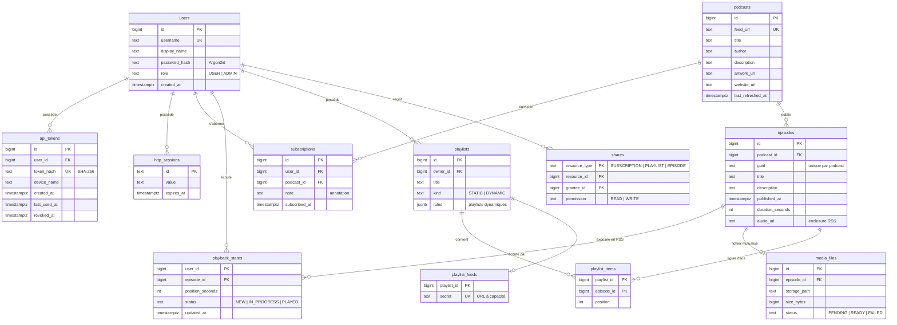

# Modèle de données

Base PostgreSQL du service, gérée par migrations Flyway et lue par SQLDelight (ADR 0004). Le modèle complet est décrit ici. Chaque table est créée par la migration de l'étape qui l'utilise : on ne crée pas de table sans code qui s'en sert.

## Principes

- **Catalogue mutualisé, état par utilisateur.**
  - Les podcasts, les épisodes et leurs fichiers audio existent une seule fois sur le serveur, quel que soit le nombre d'abonnés.
  - Ce qui dépend de l'utilisateur vit dans des tables séparées, clé `user_id` : abonnement, annotation, position, statut, playlists.
- **Propriétaire + partages** (ADR 0005) : les ressources partageables (abonnements, playlists, épisodes recommandés) ont un `owner`, et `shares` donne `READ` ou `WRITE` à d'autres utilisateurs.
- **Secrets** : seul le hash des mots de passe (Argon2id) et des jetons (SHA-256) est stocké.
- **Clés** : `BIGSERIAL` en base, exposées comme chaînes opaques dans l'API.
- **Dates** : `TIMESTAMPTZ` en base, ISO 8601 UTC dans l'API.

## Diagramme

## Tables par étape

| Table | Rôle | Créée à |
|---|---|---|
| `users`, `api_tokens`, `http_sessions` | Comptes, jetons d'appareil, sessions du client léger | Étape 3 (`V1`) |
| `podcasts`, `episodes` | Catalogue mutualisé | Étape 3 (`V1`) |
| `subscriptions` | Abonnements par utilisateur (+ annotation) | Étape 3 (`V1`) |
| `playback_states` | Position et statut par utilisateur et par épisode | Étape 3 (`V1`) |
| `media_files` | Fichiers audio téléchargés et mutualisés, purge | Étape 4 |
| `shares` | Partages et droits | Étape 6 |
| `playlists`, `playlist_items`, `playlist_feeds` | Playlists statiques et dynamiques, flux RSS | Étape 7 |

## Règles

- **Absence d'état** : un épisode sans ligne dans `playback_states` vaut `NEW`, position 0.
- **Écouté** : marquer un épisode comme écouté met `status = PLAYED` et `position_seconds = duration_seconds`. Le marquer comme non écouté supprime la ligne.
- **Suppression d'un podcast** : elle supprime ses épisodes, et donc les états d'écoute qui s'y rapportent (`ON DELETE CASCADE`). Un podcast n'est supprimé que lorsqu'il n'a plus d'abonnés (étape 4).
- **Unicité** : `(podcast_id, guid)` identifie un épisode lors des rafraîchissements du flux. `feed_url` identifie un podcast.
